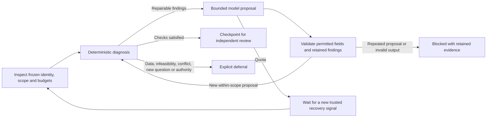

# AEP-004: durable scientific-method correction episodes

Implementation date: 2026-11-17. Opt-in worker components, not automatic production
candidate scheduling or scientific certification. AEP-005 owns independent review
and AEP-007 owns controller integration. Existing campaigns are unchanged.

## Architecture

`worker/src/swarm_worker/method_episode.py` reuses `EpisodeStore` from engineering
episodes: exclusive task-local locking, atomic fsync/replace checkpoints, integrity
digests and immutable bindings. It does not add a service or a second scheduler.



Diagnosis runs before the first model call and after every correction. A model
cannot declare success, change an identity/support-minima object, select a shell
command, grant authority, or publish a candidate. Top-level permitted method fields
are frozen in the policy. The task producer must choose those fields conservatively
and supply domain checks for their semantics: preserving JSON identity is not proof
that a changed estimator still answers the same scientific question.

The terminal success label is `ready_for_independent_review`, never `approved`.
Every result retains false scientific-approval and execution-authority flags.

## Durable record and budgets

Bindings include task, source commit, mandate digest, finding-set digest, initial
proposal and policy. A changed binding cannot reopen the same episode. Proposals,
complete diagnostic/model results, evidence and finding references are retained in
the digest-protected state; the prompt receives a compact attempt ledger and all
current findings. `read_evidence` resolves only retained content hashes.

Payloads are bounded to 256 KiB; accumulated evidence to 3 MB; context has a separate
policy bound. Overlarge context defers explicitly instead of dropping requirements.
The caller must perform a separately governed compaction or create a successor.

Call and worst-case tool-work reservations persist **before** external effects.
Interrupted calls remain charged. Repairs, model/tool calls, elapsed deadline and
reserved work never reset on retry or quota recovery. Unknown token usage stays
unknown rather than being reported as free. The controller never refunds native
work merely because a tool reports fewer actual units.

Quota and expired authority wait for a new caller-owned recovery token. An unchanged
token does not cause another model retry. Every effect rechecks the authority
callback. Data/scientific/budget deferrals cannot be reopened by a capacity token;
changed evidence or authority needs a separately bound successor. Repeated proposals
are blocked, not paid for indefinitely.

## Adapters and invocation

`NativeDiagnosticClient` runs only Bulletproof's fixed AEP-003 CLI, in its pinned
checkout, with no shell or inherited credential environment. It bounds inputs,
outputs, calibration work and subprocess duration, kills the process group on
cancellation, and verifies source/subject/request/catalog/receipt digests. The native
CLI independently refuses dirty source. A trusted diagnosis adapter interprets
receipts against the **specific frozen requirements**, not universal power cutoffs.
Subprocess crashes are not converted into scientific evidence.

`executors.method_episode.correction_proposer` adapts the existing governed Codex
runner. It retains operation-specific logs, schema and response; supplies complete
current evidence; checks provider capacity; and preserves subscription/API routing.
It asks for a structured method-field correction, not code changes or a verdict.
The shared runner now terminates children when cancelled. No paid model was invoked
to validate this change.

An authorized integration constructs `MethodEpisode` with a trusted native
`diagnose` callback, this `propose` adapter, and a synchronous current-authority
check. Diagnosis must bind the native receipts to the current proposal and refuse
unsupported checks; it must not trust the model to evaluate its own correction.
The callbacks are trusted application code, not model-supplied plugins. Model
selection of new diagnostics and broader live routing are not silently enabled.

## Verification and limits

Focused verification runs the method, engineering, provider-capacity, billing-lane
and discovery-contract suites, including the explicit native integration tests.
The final combined run passed 195 tests on 2026-11-17.
Tests exercise three repair types (history, uncertainty blocks, causal lag), each
deferral, unchanged proposals, changed source/policy, concurrent access, crash
reservations, quota recovery, authority revocation, deadline cancellation, context
overflow, model schema parsing and real subprocess cleanup. Three additional
opt-in tests execute the real clean-source Bulletproof CLI while scripted model
fixtures repair missing design-contract fields. They preserve native calibration
obligations and do not certify their synthetic methods.

Run the actual native integration explicitly:

```bash
BULLETPROOF_DIAGNOSTIC_REPO=/home/omenka/Projects/bulletproof_bt \
  worker/.venv/bin/python -m pytest \
  worker/tests/test_method_episode_native_integration.py -q
```

This demonstrates local controller/adapter mechanics, not the quality of autonomous
scientific reasoning. Genuine candidate commissioning, independent design review,
production task routing and end-to-end acceptance remain separate. Rollback is to
not select the opt-in adapter; do not delete retained episode state or reassign old
tasks to a different source.
