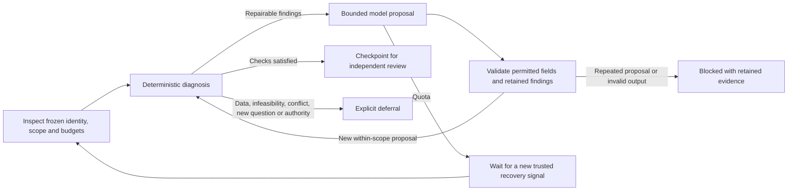
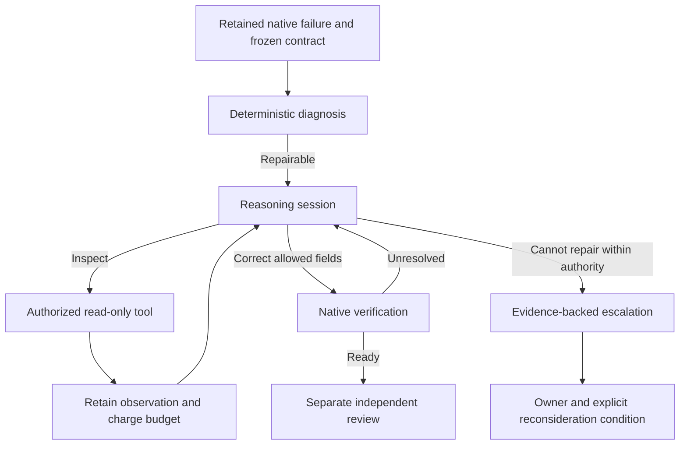

# AEP-004: durable scientific-method correction episodes

Implementation date: 2026-11-17. Opt-in worker components, not automatic production
candidate scheduling or scientific certification. AEP-005 owns independent review
and AEP-007 owns controller integration. Existing campaigns are unchanged.

## Architecture

`worker/src/swarm_worker/method_episode.py` reuses `EpisodeStore` from engineering
episodes: exclusive task-local locking, atomic fsync/replace checkpoints, integrity
digests and immutable bindings. It does not add a service or a second scheduler.



Diagnosis runs before the first model call and after every correction. A model
cannot declare success, change an identity/support-minima object, select a shell
command, grant authority, or publish a candidate. Top-level permitted method fields
are frozen in the policy. The task producer must choose those fields conservatively
and supply domain checks for their semantics: preserving JSON identity is not proof
that a changed estimator still answers the same scientific question.

The terminal success label is `ready_for_independent_review`, never `approved`.
Every result retains false scientific-approval and execution-authority flags.

## Durable record and budgets

Bindings include task, source commit, mandate digest, finding-set digest, initial
proposal and policy. A changed binding cannot reopen the same episode. Proposals,
complete diagnostic/model results, evidence and finding references are retained in
the digest-protected state; the prompt receives a compact attempt ledger and all
current findings. `read_evidence` resolves only retained content hashes.

Payloads are bounded to 256 KiB; accumulated evidence to 3 MB; context has a separate
policy bound. Overlarge context defers explicitly instead of dropping requirements.
The caller must perform a separately governed compaction or create a successor.

Call and worst-case tool-work reservations persist **before** external effects.
Interrupted calls remain charged. Repairs, model/tool calls, elapsed deadline and
reserved work never reset on retry or quota recovery. Unknown token usage stays
unknown rather than being reported as free. The controller never refunds native
work merely because a tool reports fewer actual units.

Quota and expired authority wait for a new caller-owned recovery token. An unchanged
token does not cause another model retry. Every effect rechecks the authority
callback. Data/scientific/budget deferrals cannot be reopened by a capacity token;
changed evidence or authority needs a separately bound successor. Repeated proposals
are blocked, not paid for indefinitely.

## Adapters and invocation

`NativeDiagnosticClient` runs only Bulletproof's fixed AEP-003 CLI, in its pinned
checkout, with no shell or inherited credential environment. It bounds inputs,
outputs, calibration work and subprocess duration, kills the process group on
cancellation, and verifies source/subject/request/catalog/receipt digests. The native
CLI independently refuses dirty source. A trusted diagnosis adapter interprets
receipts against the **specific frozen requirements**, not universal power cutoffs.
Subprocess crashes are not converted into scientific evidence.

`executors.method_episode.correction_proposer` adapts the existing governed Codex
runner. It retains operation-specific logs, schema and response; supplies complete
current evidence; checks provider capacity; and preserves subscription/API routing.
It asks for a structured method-field correction, not code changes or a verdict.
The shared runner now terminates children when cancelled. No paid model was invoked
to validate this change.

An authorized integration constructs `MethodEpisode` with a trusted native
`diagnose` callback, this `propose` adapter, and a synchronous current-authority
check. Diagnosis must bind the native receipts to the current proposal and refuse
unsupported checks; it must not trust the model to evaluate its own correction.
The callbacks are trusted application code, not model-supplied plugins. Model
selection of new diagnostics and broader live routing are not silently enabled.

## Verification and limits

Focused verification runs the method, engineering, provider-capacity, billing-lane
and discovery-contract suites, including the explicit native integration tests.
The final combined run passed 195 tests on 2026-11-17.
Tests exercise three repair types (history, uncertainty blocks, causal lag), each
deferral, unchanged proposals, changed source/policy, concurrent access, crash
reservations, quota recovery, authority revocation, deadline cancellation, context
overflow, model schema parsing and real subprocess cleanup. Three additional
opt-in tests execute the real clean-source Bulletproof CLI while scripted model
fixtures repair missing design-contract fields. They preserve native calibration
obligations and do not certify their synthetic methods.

Run the actual native integration explicitly:

```bash
BULLETPROOF_DIAGNOSTIC_REPO=/home/omenka/Projects/bulletproof_bt \
  worker/.venv/bin/python -m pytest \
  worker/tests/test_method_episode_native_integration.py -q
```

This demonstrates local controller/adapter mechanics, not the quality of autonomous
scientific reasoning. Genuine candidate commissioning, independent design review,
production task routing and end-to-end acceptance remain separate. Rollback is to
not select the opt-in adapter; do not delete retained episode state or reassign old
tasks to a different source.

## Reasoning-led investigation increment (2026-11-27)

Implemented as an opt-in extension of this episode, not a second controller.
An exact task policy may name `investigation_tools`. The production adapter accepts
only `inspect_contract`, `read_evidence`, `inspect_native_source`, and
`reproduce_diagnostic`. The API and worker share parity-tested capability definitions.
Empty policies serialize exactly as before; historical task digests do not change.



The model selects the next inspection or correction; the controller does not match
specific error-message strings. Complete observations, proposals and prior events
are retained across model calls. This is durable application-owned session context,
not a persistent provider conversation: the existing ephemeral Codex invocation
receives the reconstructed evidence each turn. Reviewers remain separate.

Source inspection reads a Python blob from the exact authorized Git commit, never
the mutable checkout. Paths, output size and duration are bounded; there is no
model-selected shell command. Diagnostic reproduction invokes only the existing
approved native diagnostic. No new calibration or market-data execution is granted.
Inspections consume the same tool-call and worst-case work budgets as diagnostics;
model-selected actions consume model calls. Interruptions do not refund reservations.
Identical inspection requests against an unchanged proposal stop instead of looping.

Escalations record a disposition, evidence, owner and recovery condition. Shared
code defects use `infrastructure_repair`; they are proposals, not permission to edit
or deploy platform code. Other dispositions cover missing data, infeasible science,
conflicts, changed questions and authority/capacity. Independent review is still
required after a correction passes native checks.

Verification includes scripted timing/normalization/uncertainty repairs through the
same controller, scope and authority violations, interrupted reservations, immutable
source reads, model action parsing and worker-to-API result publication. These tests
prove controller mechanics, not live reasoning quality or end-to-end autonomy.
The November 27 verification run passed 195 backend tests and 190 worker tests,
including discovery schema regressions and the method/review/handoff suites.
An additional production-adapter regression covers each of the four registered
tools through observation, correction, native recheck, review-packet publication
and checkpoint reuse. The complete adapter file passes 20 tests. Model and native
diagnostic responses are mocked in these four cases; pinned-source lookup and
episode/result transport use the implementation. Missing pinned files return
explicit unavailable observations rather than invented source or forced retries.

### Observation custody repair (2026-11-28, local validation)

Authorized tool observations now participate in the correction output schema,
native diagnostic evidence catalog and API receipt verification. Previously the
episode retained observations but those downstream consumers still required the
initial catalog, preventing a correction from citing newly inspected evidence.
The worker and API share parity-tested catalog construction. Only recorded tool
observations are added; arbitrary retained author output is excluded, and a
`read_evidence` reread cannot promote an author claim. Digests are checked, old
catalog receipts remain valid when no new evidence is referenced, and independent
scientific review is unchanged. Tests cover citation through correction, native
recheck, checkpoint reuse, publication and rejection when observation custody is
removed. These are synthetic tests, not live scientific acceptance.

The accompanying local implementation adds opt-in `search_evidence` through the
existing hybrid retrieval service. Its immutable task contract pins the project,
public/internal access ceiling, result count and excerpt bound. A live task lease
and current method authority are required. Reservations are retained before search;
identical completed operations replay their receipt, while interrupted operations
remain charged and are not silently repeated. Stale projections and out-of-scope
results fail closed. Citation coordinates remain unchanged and excerpt truncation
is explicit. Worker callbacks are task-local; credentials are not model inputs.

This extension was deployed with commit `6b875e8` on November 28 (rollout below).
It is not live commissioned. No additional live model calls are authorized by
deploying this code.

### Non-calibration requirements adapter (2026-11-28, local validation)

An explicitly approved `requirements_feasibility_v1` method task can now use the
existing durable episode without inventing a calibration design. Its
`requirements-method-repair-v1` proposal references immutable planning inputs.
The adapter permits only a subset of specification fields selected by the task's
approved policy: estimator, uncertainty procedure, missing-data policy,
event-support rationale and falsification rule. Target equation, threshold rule,
controls, splits and quantile support plans remain frozen. The complete candidate
identity, support requirements, data bindings, coverage, windows and planning work
limits remain bound to the input digest. A change outside that boundary needs a
separately authorized successor, not a repair disguised as the same experiment.

The prospective native input drops the old requirements review receipt. Static
readiness is checked against the exact native report and both validation plans;
it does not prove effect meaningfulness, dependence assumptions, observed support,
scientific acceptance or execution authority. Fresh independent review remains
mandatory. A native deferral enters bounded investigation/correction; the session
must escalate if resolution needs changes outside its authority.

Local tests exercise scoped corrections, immutable-field rejection, API receipt
verification, worker repair and restart reuse. An additional offline replay used
a temporary snapshot of Bulletproof `b9b19c2ce109392196e272920355af10f53a544e`,
not its newer working-tree HEAD. Synthetic 370-day coverage produced ready plans
(receipt `9d0bad4d4bd0f7b2e346784b5edf5fe6844b3f2d9055f65eed95b7aff65cabd7`);
31-day coverage remained deferred for insufficient scientific history (receipt
`6ae0f8186df7c7a1fe897fde1246697ae9d1784b0fd8e8161a599847398ca10a`).
No market data, paid inference or backtest was used in that replay.

The combined local checks passed 256 backend tests (requirements adapter,
evidence retrieval, method tasks, recovery lineage and requirements handoff) and 126 worker tests
(task-local search, method adapter/controller, provider adapter, worker service and
API client). Model correction responses in the episode regression are scripted;
the separate pinned-source planning replay above uses the actual native code.

Still outstanding: source-bound commissioning, independently reviewed recovery of
the genuine rejected candidate, and materialization of its corrected specification
with a newly bound requirements basis and fresh review receipts. The adapter does
not silently overwrite an admitted candidate or carry old approval into engineering.

### Commissioning still required

Rollout evidence, November 28: `6b875e8` pushed to main; VM2 API healthy at image
`sha256:80d15cc8c5a2da627aef15bd413dc458aee9535688e9e6c15b259f849706a732`,
started 00:46:21 UTC. The deployed OpenAPI includes the task-scoped evidence route
and the schema includes both native diagnostic modes. VM1 method designer restarted
at 00:46:56 UTC after the API reported no active tasks. No broad worker restart,
discovery activation, graph rebuild or live model call was performed.

The retained genuine candidate's prospective contract validates at 105,246 bytes.
This is a shape/custody check, not scientific acceptance. Method-only mandate
`44867788-9e75-4d33-b2a7-bc438525c733` is awaiting exact-digest approval:
`8379b9c148140c7bb312f0fec4f374e925ab2bf52c96dab8e82a7a689c3a77c4`.
Discovery is disabled; expiry is November 28 at 08:49:58 UTC. Campaign activation
remains separate. The old campaign is `completed_no_candidate` and unchanged.

- Opt in an explicitly authorized method episode on the deployed extension.
- Observe genuine tool selection, diagnosis and repair without operator hints.
- Run materially different hypotheses and deliberate infeasible/data-limited cases.
- Integrate approved investigation adapters with discovery, representation and
  engineering recovery. This increment does not make those stages use this session.
- Verify independent review, downstream execution, publication and replenishment.
- Measure completion without intervention, valid escalation, repair success, total
  latency and model usage; do not optimize call count at the cost of completion.

The narrow archive gate-reference mandate approved on November 27 does not authorize
this broader commissioning. Existing campaigns and historical counters remain intact.
