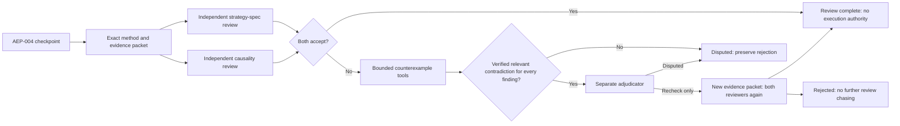

# AEP-005: evidence-based method review and adjudication

Implemented locally on 2026-11-17. Opt-in components, not a replacement for the
production AGT-006 route or its requirements-approval receipts. No production
candidate, model call, mandate or trading action was started by this change.

## Exact review boundary

`worker/src/swarm_worker/method_review.py` bridges an AEP-004
`ready_for_independent_review` checkpoint to a bounded immutable review packet.
It binds the checkpoint, source, complete proposal, current and prior requirements,
retained evidence and dependency digests. The changed-criteria list is computed,
not model-authored. Reviewers still check every current criterion.

The controller reuses `EpisodeStore` for exclusive locking, atomic checkpoints and
digest validation. Reviewer assignments, adjudicator, producer identities and policy
are frozen in the binding. A changed source, dependency, evidence, profile or policy
cannot reuse the old episode. `current` must verify real authority, dependency
validity and current evaluator registrations before invoking work or returning cached
acceptance. Revocation hides the cached acceptance without deleting its history.

Both `strategy_spec` and `causality_leakage` must accept. Producer, reviewers and
adjudicator must have distinct agent IDs and context groups. This is separation of
roles/context, not a claim of statistically independent model families. Production
callers must resolve and attest these identities through AGT-006; they cannot be
accepted from model output. A bare dictionary is not proof of registration.

## Findings and counterexamples

Every rejected finding names a concrete criterion, recorded evidence digests,
violation and reproducible verification procedure. Missing criteria, invented
evidence, partial checklists and approval with unresolved findings fail closed.
Malformed outputs are retained as invalid, not silently converted to approval.

Counterexample tools are trusted deterministic application callbacks using approved
native tools, not arbitrary model-generated commands. Each receipt must match the
packet, exact finding and criterion. A separate custody verifier must confirm the
actual tool invocation, execution/source bindings, work bound and applicable result
semantics. Content hashing alone is not authentication or scientific relevance.
Unsupported or inconclusive checks cannot be relabelled as contradictions.

The controller does not spend an adjudication call when recorded evidence cannot
possibly cover all rejected findings. The adjudicator can only return `recheck` or
`disputed`, never approve. A recheck requires directly relevant contradictory
receipts for every rejected finding. Added evidence invalidates **both** verdicts;
fresh review uses the same fixed evaluators. Old verdicts remain in the ledger.
There is at most one recheck, and a fresh rejection terminates the episode.

Reviewers do not receive peer verdicts. They receive the frozen criteria and
recorded evidence. The adjudicator receives both verdicts and counterevidence.
Neither reviewer nor adjudicator can mutate the proposal or relax requirements.

## Runtime and cost controls

`executors.method_review.review_callbacks` adapts existing governed Codex runtimes
using exact identity-to-runtime mappings, ephemeral read-only calls, structured
outputs, retained operation logs, provider-capacity checks and existing billing-lane
routing. Missing runtimes do not fall back to the author or another reviewer.

Model calls and worst-case tool work are reserved before effects. Crashes and
quota waits do not refund calls or reset the deadline. Capacity requires a new
trusted recovery token. Oversized contexts defer before paying for a model call;
requirements are never silently truncated. Token cost is not inferred from call
counts. Native calibration results are evidence, not automatic scientific approval.

`review_complete` is a local review outcome. Both scientific-approval and execution-
authority flags remain false. AEP-006/AEP-007 must validate the accepted packet and
registered review custody at materialization; this module cannot create live tasks
or substitute for the existing production review registry.

## Verification and remaining acceptance

Tests cover legitimate defects, false fixture findings, directly computed causal-
lag/history/split-gap counterexamples, unrelated successes, missing evidence,
invented criteria, author/reviewer identity collisions, cache invalidation,
revocation, complete re-review, crash/quota budgets, deadlines, model adapters and
the AEP-004-to-AEP-005 checkpoint bridge. No paid model is used in these tests.

These are developer-labelled controlled fixtures. Independent human/scientific
label adjudication and genuine-candidate reasoning evaluation remain commissioning
work; the test suite is not represented as independent scientific ground truth.
Production routes have not been enabled or rewritten. Rollback is to leave these
opt-in adapters unselected while retaining all historical evidence.

Verification on 2026-11-17: 109 focused worker regressions and 13 Research Bible
tests passed. No production route, source transition or deployment was performed.
