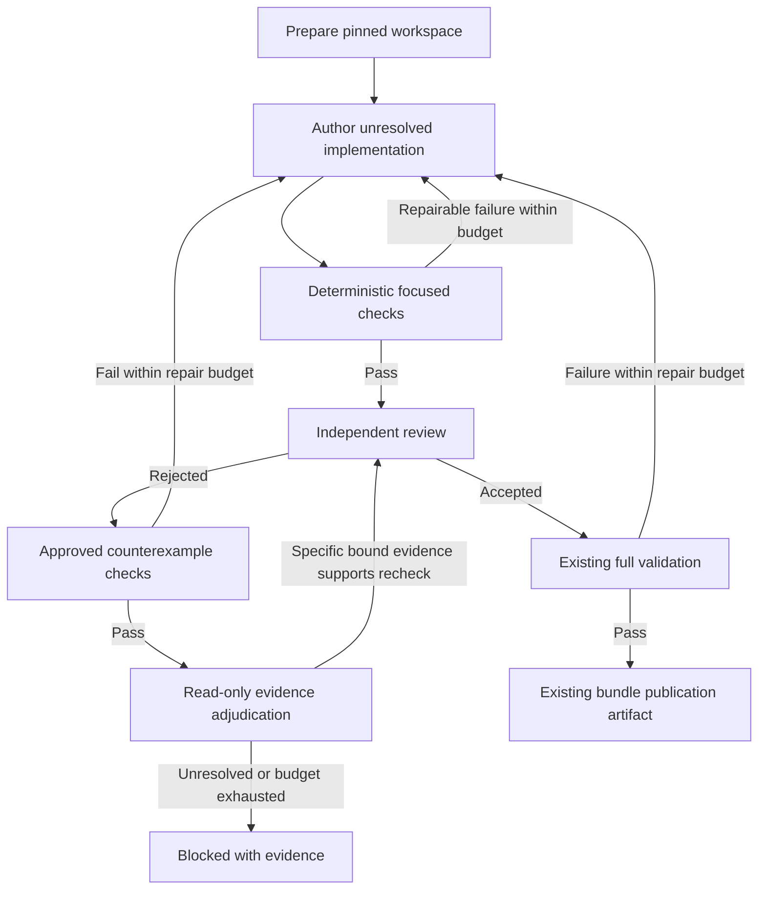

# Durable engineering episodes

Status: opt-in implementation; offline infrastructure validation only. Not deployed
or scientifically certified. Existing tasks are not migrated or resumed.

## Evidence and architectural decision

The controlled comparison in `native-authoring-parity-20261116.md` found that
both direct and worker-prompt authors produced runnable implementations. Additional
tests exposed different semantic defects; a bounded correction in each retained
workspace repaired them. Subsequent reviews included findings contradicted by
runner or loader evidence. Those observations do not demonstrate that independent
review is unnecessary, nor that modern admission contracts already pass.

The existing `EngineeringMissionExecutor.execute` uses a linear author, focused
correction, review, validation and bundle path. Campaign-level successor recovery
can introduce new tasks and handoffs. The first change is deliberately inside one
approved engineering task, not a replacement discovery or campaign orchestrator.

Alternatives considered:

- Continue generating successor tasks for every implementation defect: durable
  task history, but repeated context reconstruction and workspace loss.
- One unconstrained author/reviewer session: convenient repair, but weak separation
  between implementation, acceptance criteria and approval.
- Selected: a durable controller with retained workspace, bounded author repairs,
  deterministic checks and separate read-only review/adjudication calls.

Retained workspace and structured diagnostics provide continuity. The model calls
remain ephemeral; this is not a persisted Codex conversation session.

## Contract and execution

`engineering_episode` is optional in backend proposal, worker proposal and executor
contract schemas. Its approved policy includes test selectors, repair, model-call
and adjudication caps. Only Codex authoring currently supports this path. Producers
must explicitly opt in through a new approved contract; old digests are unchanged.

The controller in `worker/src/swarm_worker/engineering_episode.py` persists state
atomically with fsync, checks a state digest, and excludes concurrent execution
using a file lock. Binding includes task, full contract, source and workflow
digests. It reserves model calls before execution. Crashes do not reset budgets
or the wall-clock deadline. The adapter in
`worker/src/swarm_worker/executors/engineering_episode.py` restores a prior
attempt's patch and evidence into a new attempt under the same task, refusing
conflicts, symlinks and binding changes. This requires the task's local storage
to survive; it is not cross-machine replicated durability.

Every completed stage records a code-bound receipt. Code changes invalidate prior
acceptance. Checks, review, adjudication, validation and bundling cannot modify
tracked implementation without failing closed. Adjudication cannot approve a
bundle: a recheck must cite recorded passing checks for the same code, and a fresh
independent review must accept it. An unrelated passing test is not proof that a
finding is unsupported. Empty additional-check configuration explicitly says so.
The controller verifies receipt identity, not the semantic truth of an LLM claim.

Quota and timeout outcomes defer the episode instead of looping internally.
Provider-capacity scheduling remains the surrounding worker's responsibility.
The deadline continues while deferred; exhausted work requires governed recovery.
Integrity digests detect accidental corruption, not a malicious filesystem owner.

## Validation and measurement

`worker/tests/test_engineering_episode.py` covers repair budgets, interruption,
capacity deferral, disputed and malformed adjudication, read-only mutation,
state integrity and completion invalidation.
`worker/tests/test_engineering_episode_executor.py` uses real Git workspaces,
pytest subprocesses and the existing validation/bundle adapter with mocked model
responses. It exercises threshold, aggregation and lag mechanisms and restoration
into a second worker attempt. These are not genuine scientific hypotheses.

The episode summary records repairs, model calls, completed-stage elapsed time,
CLI-reported tokens where available, calls without usage, review rejections and
recheck acceptances. CLI token counts are not monetary cost. Interrupted calls
remain charged against the call budget but their usage/latency may be unknown.
Review recheck acceptance is not automatically an unsupported-rejection verdict.

## Remaining commissioning gates

1. Opt in a small set of approved real candidates with frozen focused and review
   test selectors; retain production parity and unchanged scientific contracts.
2. Exercise real model review, deliberate semantic failure, quota deferral and
   interrupted recovery. Independently label whether disputed findings are valid.
3. Follow accepted bundles through existing campaign materialization, genuine
   smoke and scientific runs, BT-009 publication and memory. This module does not
   replace or itself prove those downstream paths.
4. Compare intervention-free completion, bounded repair success, review accuracy,
   latency and usage with the prior path before enabling broad throughput.

No scientific gate, mandate, source authorization, shadow or capital authority
is bypassed by this policy. Arbitrary new counterexample commands and changed
scientific questions remain outside the approved episode.
