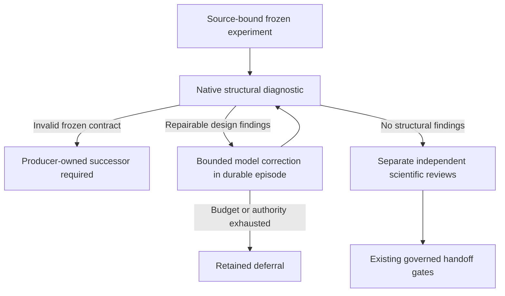

# Experiment-to-calibration consistency

Status: implemented locally and tested offline. Not deployed or commissioned on
a production candidate. This is a structural checking and bounded-repair increment,
not scientific certification or proof of autonomous research quality.

## Architecture

The existing method episode remains the durable coordinator. No additional agent
is introduced. New source-bound contracts can carry two method fields:

- `experiment`: frozen variants, multiplicity-family membership, partition row
  counts, scientific/diagnostic purpose, statistic identifier and inner-replicate
  count. Each variant declares a nominal event probability or null when no event
  model is registered. Only a separately authorized successor can change this.
- `calibration_design`: repairable scenario definitions, exact family membership,
  variant-by-partition event assumptions, joint generation, null/effect rules,
  estimator application, seed schedule and outputs. Scenario event-rate mode
  distinguishes registered assumptions from explicit sensitivity assumptions.

The producer must ground the frozen experiment in the reviewed specification.
This increment does not infer trustworthy experiment facts from arbitrary prose.
Prose-only historical contracts remain `unverified_legacy_prose`; no history or
approval digest is rewritten. Both fields must be present together; an empty
design can receive concrete native findings. `experiment` is never an allowed
author repair field. `calibration_design` must be explicitly authorized.

Native implementation:
`bulletproof_bt/src/bt/governance/calibration_consistency.py`, invoked by
`design_adequacy.py` through the existing diagnostic tool. Source receipts include
the implementation hash. Findings carry code, path, owner and disposition.
Invalid experiment definitions require producer recovery; authors cannot quietly
change them. Repairable findings enter `AlphaMethodDesignExecutor` and the existing
`MethodEpisode` correction/recheck loop. Author output uses a closed structured
schema and general correction guidance in `swarm_worker/calibration_design.py`.
Backend result validation requires a zero-finding native consistency receipt for
structured contracts before accepting review readiness.

## What Is Checked

- Each registered DGP is defined exactly once.
- Every registered family binds its exact variant membership.
- Every variant/partition has an explicit event assumption or non-event declaration.
- Expected events equal partition rows times the stated probability. Expectations
  are not observed support; fitted thresholds need separate scientific assessment.
- Registered event probabilities cannot silently change. Sensitivity scenarios
  declare a separate assumption rather than masquerading as the registered case.
- Statistic, purpose and replicate schedule match the frozen procedure. A cheaper
  diagnostic requires its own declared contract, not implicit scientific equivalence.
- Joint generation, parameterization, estimator use, seeds and outputs are present.

No asset names, four-variant constant, quantile constant or bootstrap replicate
constant drives these checks. Continuous-statistic fixtures need not invent event
groups. The current tool remains scoped to the existing resampling-calibration
contract; it is not a universal validator of every possible statistical method.

## Limits and Evidence

Presence checks do not prove that DGP prose is executable, scientifically defensible
or equivalent to the fitted estimator. Reviewers retain those responsibilities.
The legacy residual-calibration probe cannot execute arbitrary structured designs;
it returns `await_engineering` instead of approximating their joint experiment.
No calibration results, power claims or execution authority are created here.

Native regression cases include single-, four- and six-variant designs, continuous
statistics, sensitivity assumptions, malformed contracts and the R4 failure pattern
(one-pair family coverage, inconsistent event counts and replicate mismatch).
The corrected fixtures demonstrate consistency, not a scientifically accepted BTC
method. A worker test uses a stubbed author to prove native findings -> bounded
correction -> native recheck -> review readiness and free checkpoint reuse. Another
proves invalid frozen definitions spend no author call. These are orchestration
tests, not evidence of actual model correction quality.

## Commissioning Boundary

Before live use: release the new Bulletproof source, bind a successor to it, have
the producer supply the grounded frozen experiment, obtain exact bounded authority,
then observe genuine correction and fresh reviews. Test several materially different
questions and deliberate failures before claiming general autonomous repair.
Existing R4 evidence and spent authority remain unchanged.

### Deployment and Controlled Commissioning, 2026-11-17

- Bulletproof `f81fb7d2a7a2e3cab654b3b860dab711d85237f7` and control plane
  `2274919` were pushed to main. VM2's rebuilt API reports healthy and its
  campaign director is active; VM1's method designer was started with the repair.
- A bounded BTC admission check completed successfully (one CPU, 2 GiB limit,
  27 seconds). Registered receipt: `60fc5e9b-5593-428f-9e2e-4fc92fb225b9`,
  digest `774b880319598afc03947f84420a69867e4bc56e7dc7d70d6a9d7ec7195dad44`.
- Founder approved mandate `ALPHA004-AEP007-CONSISTENCY-20261117`, digest
  `c1742f7a15f87c06f2764ec685a56aeb1fb7ce1398c520f0624226eaf21b6e21`.
- Founder separately approved method campaign
  `e87a1b1b-d98a-4695-9715-707105637d3b`, digest
  `fbd6a3505b887aa15f087d89bfa863f130d31782a4ae094293a75d8863b461e3`.
  It permits two author corrections and four diagnostics, followed by fresh
  independent reviews, until 2026-11-17 20:17:06 UTC.
- The 79,491-byte method contract retains R4's proposal and review evidence.
  Its frozen experiment is an explicit commissioning projection of retained
  quantiles/reference windows, Holm families, minimum partition sizes and
  bootstrap count. Nominal event probabilities are assumptions, not observed
  support. Automatic producer population across arbitrary questions remains
  unproved.

### Observed Result and Remaining Handoff Gap

Task `2eb5b85a-9f1f-4aef-ad21-85d57bc8534c` succeeded with one actual author
call, two native diagnostics and one repair. Its terminal state is
`ready_for_independent_review`, with no structural findings. This is genuine
correction evidence for this candidate, not general scientific certification.

Independent review tasks `d7c0d0b8-68e9-4f52-ad30-e064eed385d9` and
`17e5551e-67f2-4df1-8822-5ee7f0b6390a` were materialized but released before
model execution: their 153,635-byte input exceeds the worker's 100,000-byte
review-contract bound. The qualification contains a 31,359-byte card and
121,057-byte artifact bundle. Both reviewer units were stopped to contain
repeated lease/release churn; the scientific verdict remains pending.

### Lossless Review Handoff Repair

The worker now builds a bounded, content-addressed context for method reviews.
Exact repeated subtrees (including repeated long strings) appear once in an
object table; references use the canonical original-value digest. The immutable
task, routed subject, packet, card and artifact digests do not change. No source
evidence is summarized, truncated or omitted. Original method evidence is bounded
at 256 KiB and the deduplicated context at 100,000 bytes. Other review scopes
retain the original 100,000-byte bound. Unique oversized evidence fails closed.

The API has the same admission implementation before review-task publication;
a parity test requires its isolated copy and the worker copy to be byte-identical.
This API guard is locally tested but not yet deployed to VM2. VM1 reviewers were
restarted with the consumer repair. Both existing contracts validate at roughly
94,400 context bytes. Tests cover lossless reconstruction, original hashes,
legacy context, reserved-reference collisions, producer/consumer parity and
rejection before task persistence.

Strategy-spec review `d7c0d0b8-68e9-4f52-ad30-e064eed385d9` subsequently
succeeded with `approve` and no blockers. Causality review still holds a
pre-restart lease expiring at 2026-11-17 18:51:00 UTC; it has no verdict yet.
Both reviewer services are running. No duplicate review was forced.

Both independent acceptances remain necessary. This commissioning grants no
engineering, calibration execution, backtests, orders or promotion authority.
