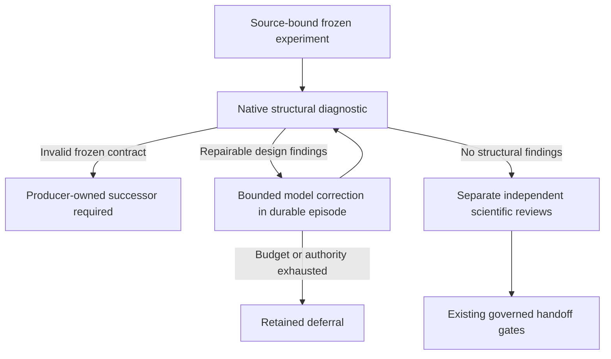

# Experiment-to-calibration consistency

Status: implemented locally and tested offline. Not deployed or commissioned on
a production candidate. This is a structural checking and bounded-repair increment,
not scientific certification or proof of autonomous research quality.

## Architecture

The existing method episode remains the durable coordinator. No additional agent
is introduced. New source-bound contracts can carry two method fields:

- `experiment`: frozen variants, multiplicity-family membership, partition row
  counts, scientific/diagnostic purpose, statistic identifier and inner-replicate
  count. Each variant declares a nominal event probability or null when no event
  model is registered. Only a separately authorized successor can change this.
- `calibration_design`: repairable scenario definitions, exact family membership,
  variant-by-partition event assumptions, joint generation, null/effect rules,
  estimator application, seed schedule and outputs. Scenario event-rate mode
  distinguishes registered assumptions from explicit sensitivity assumptions.

The producer must ground the frozen experiment in the reviewed specification.
This increment does not infer trustworthy experiment facts from arbitrary prose.
Prose-only historical contracts remain `unverified_legacy_prose`; no history or
approval digest is rewritten. Both fields must be present together; an empty
design can receive concrete native findings. `experiment` is never an allowed
author repair field. `calibration_design` must be explicitly authorized.

Native implementation:
`bulletproof_bt/src/bt/governance/calibration_consistency.py`, invoked by
`design_adequacy.py` through the existing diagnostic tool. Source receipts include
the implementation hash. Findings carry code, path, owner and disposition.
Invalid experiment definitions require producer recovery; authors cannot quietly
change them. Repairable findings enter `AlphaMethodDesignExecutor` and the existing
`MethodEpisode` correction/recheck loop. Author output uses a closed structured
schema and general correction guidance in `swarm_worker/calibration_design.py`.
Backend result validation requires a zero-finding native consistency receipt for
structured contracts before accepting review readiness.

## What Is Checked

- Each registered DGP is defined exactly once.
- Every registered family binds its exact variant membership.
- Every variant/partition has an explicit event assumption or non-event declaration.
- Expected events equal partition rows times the stated probability. Expectations
  are not observed support; fitted thresholds need separate scientific assessment.
- Registered event probabilities cannot silently change. Sensitivity scenarios
  declare a separate assumption rather than masquerading as the registered case.
- Statistic, purpose and replicate schedule match the frozen procedure. A cheaper
  diagnostic requires its own declared contract, not implicit scientific equivalence.
- Joint generation, parameterization, estimator use, seeds and outputs are present.

No asset names, four-variant constant, quantile constant or bootstrap replicate
constant drives these checks. Continuous-statistic fixtures need not invent event
groups. The current tool remains scoped to the existing resampling-calibration
contract; it is not a universal validator of every possible statistical method.

## Limits and Evidence

Presence checks do not prove that DGP prose is executable, scientifically defensible
or equivalent to the fitted estimator. Reviewers retain those responsibilities.
The legacy residual-calibration probe cannot execute arbitrary structured designs;
it returns `await_engineering` instead of approximating their joint experiment.
No calibration results, power claims or execution authority are created here.

Native regression cases include single-, four- and six-variant designs, continuous
statistics, sensitivity assumptions, malformed contracts and the R4 failure pattern
(one-pair family coverage, inconsistent event counts and replicate mismatch).
The corrected fixtures demonstrate consistency, not a scientifically accepted BTC
method. A worker test uses a stubbed author to prove native findings -> bounded
correction -> native recheck -> review readiness and free checkpoint reuse. Another
proves invalid frozen definitions spend no author call. These are orchestration
tests, not evidence of actual model correction quality.

## Commissioning Boundary

Before live use: release the new Bulletproof source, bind a successor to it, have
the producer supply the grounded frozen experiment, obtain exact bounded authority,
then observe genuine correction and fresh reviews. Test several materially different
questions and deliberate failures before claiming general autonomous repair.
Existing R4 evidence and spent authority remain unchanged. No services, campaigns,
mandates or live trading configuration were changed by this increment.
