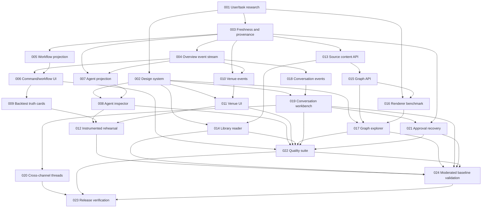

# Mission Control Investor-Readiness Tasks

These tasks turn [INVESTOR_EXPERIENCE_SPEC.md](INVESTOR_EXPERIENCE_SPEC.md) into
sequenced implementation work. A design proposal or schema registry alone does
not close a task. MCUX-001's repository-backed service blueprint is complete;
moderated human validation is tracked separately as MCUX-024 and remains open.
See [MCUX-001_VALIDATION.md](MCUX-001_VALIDATION.md).

## Delivery Rules

- Keep API, UI and tests in the same task when a partial contract would leave the
  user-facing state misleading. Split only when the dependency is independently
  useful and testable.
- Preserve the current Invariance brand foundation: white navigation/header,
  ivory canvas, bundled fonts and primary logo.
- Do not make UI status more certain than its source evidence. Unknown, stale,
  derived, replayed, demo and live states must be explicit.
- Never make Mission Control mutations bypass founder intent, risk policy,
  immutable digests or existing execution gates.
- Every task must preserve list selection, scroll and keyboard focus during
  background updates, or prove those surfaces are not refreshed in place.

## Track 0: Product and Data Foundations

### [x] MCUX-001 - Validate user tasks and service blueprint

**Scope:** Complete a repository-backed cognitive walkthrough for founder
operations, research inspection, investor demo and failure recovery. Inventory
the UI/API/data source for each step and classify every displayed fact as
canonical, derived, cached, inferred or unavailable. Record concrete journey
risks and update the investor spec only when evidence changes. This desk audit
does not claim user interviews or moderated testing.

**Depends on:** none.
**Acceptance:** a dated service blueprint and claim-to-source inventory exists
for Command, Workflows, Agents, Research, Knowledge, Execution, Conversations,
Approvals and Evidence; task journeys distinguish known from unavailable
capabilities and record recovery risks. Human task completion, interpretation
and timing are measured separately by MCUX-024 before release.

### [x] MCUX-002 - Consolidate the Mission Control design system

**Scope:** Formalize the existing logo, local font assets, ivory/white palette,
semantic state tokens, density/spacing, controls, typography, focus, reduced
motion and responsive layout. Correct drift between the CSS and `DESIGN.md`.

**Depends on:** MCUX-001.
**Acceptance:** documented tokens map to CSS variables; repeated components
share the same semantic state treatment; semantic text/status contrast and
keyboard focus/reduced-motion/responsive breakpoint contracts are automated in
`mission-control/tests/test_design_system.py`. The visual regression captures
at 375, 768, 1024 and 1440px remain in MCUX-022/023, where the full quality and
release environment is qualified.

### [x] MCUX-003 - Define UI state freshness and provenance contract

**Scope:** Specify common response metadata for `generated_at`, source time,
source identity, freshness threshold, stale reason, unavailable state, cursor
and whether a value is canonical or derived. Add API schemas and contract tests.

**Depends on:** MCUX-001.
**Acceptance:** all data used for live/healthy/current labels has a source and
freshness rule; missing metadata fails closed to `unknown`; tests cover stale,
missing, future timestamp, partial response and control-plane outage. The
versioned `mission-control-provenance-v1` response contract is implemented in
`freshness.py`; dashboard connection/snapshot copy consumes it rather than
equating successful HTTP transport with a fresh operational state.

### [x] MCUX-004 - Add bounded overview event stream

**Scope:** Add a versioned Mission Control overview plus authenticated SSE
events with resumable cursor, heartbeat, event IDs, replay/deduplication,
visibility-aware reconnect and bounded payloads. Keep a documented polling
fallback and API backoff behavior.

**Depends on:** MCUX-003.
**Acceptance:** a reconnect receives all missed events once in order or reports
that the cursor expired and supplies a fresh snapshot; duplicate events do not
duplicate UI changes; authorization secrets never enter browser payloads;
the unit-level stream load boundary caps replay at 128 events, browser
subscribers at 12, per-subscriber queue depth at 16 and payloads at 4 KiB.
The single upstream poller runs only while a browser is subscribed; the browser
uses visibility-aware reconnect with exponential backoff and 15-second polling
only as a fallback. Broader browser/load validation remains in MCUX-022/023.

### [x] MCUX-005 - Define canonical workflow instance projection

**Scope:** Project workflow definition/version, ordered stages and transitions,
instance ID, current leaf task/run, owner, machine, entry/exit evidence,
heartbeat, blockers, retries, terminal outcome and source event IDs.

**Depends on:** MCUX-003.
**Acceptance:** fixtures cover normal, waiting-approval, waiting-data, stale,
retry, cancelled, failed and terminal-receipt paths. A parent campaign state
cannot imply a running native backtest without a live leaf-run signal. The
implemented `mission-control-workflow-projection-v1` read projection binds each
instance to its source operation/campaign, leaf status, heartbeat, evidence,
blocker and retry data. Campaign native execution becomes `running` only when
the canonical backtest activity projection has a matching live execute-stage
leaf task.

## Track 1: Investor Demo and Operational Clarity

### [x] MCUX-006 - Build Command and Workflow views

**Scope:** Reorganize the first viewport around machine readiness, attention,
active workflow stages and recent outcomes. Add synchronized stage-map and
timeline views backed by the workflow projection. Keep deep links and preserve
scroll/focus across stream updates.

**Depends on:** MCUX-002, MCUX-004, MCUX-005.
**Acceptance:** users can identify current leaf work, owner, machine, heartbeat
age, blocker, next action and latest evidence without interpreting internal
campaign phase names; all workflow states have explicit accessible labels. The
Command stage map and dedicated Workflow inspector consume the same
`mission-control-workflow-projection-v1` response, retain selected workflow
state during background updates, and label the native-backtest stage separately
from the parent campaign.

### [x] MCUX-007 - Add agent detail projection API

**Scope:** Aggregate agent identity, package/deployment, charter/grants/scopes,
current lease, paginated task history, workflow memberships, heartbeat history
and artifact/log references. Expose reporting relationships only from an
explicit authoritative relationship field.

**Depends on:** MCUX-003, MCUX-004.
**Acceptance:** API tests cover no assignment, active assignment, stale agent,
multiple attempts, missing relationship and expired deployment. No secret or
lease token is returned. Unknown reporting line is represented as unknown. The
implemented `mission-control-agent-detail-v1` projection binds agent identity,
active package, charter/grants, workload identity, current lease, paginated
canonical assigned-task history, workflow memberships and available artifact/log
references. The current control-plane record exposes only a latest heartbeat,
so heartbeat-series availability is explicitly labeled rather than fabricated.

### [x] MCUX-008 - Build agent directory and inspector

**Scope:** Add agent filtering and inspector tabs for Overview, Now, History,
Workflows and Governance; expose exact source/freshness for presence and task
status. Link tasks and artifacts to their inspectors.

**Depends on:** MCUX-002, MCUX-007.
**Acceptance:** a user can determine whether the agent is actually active,
which task it owns, its recent outcomes, allowed capabilities and workflow
membership; no UI-generated reporting hierarchy is shown as canonical.
The directory retains fast local filtering while the inspector loads the safe
`mission-control-agent-detail-v1` projection on demand. Five keyboard-operable
tabs separate identity, current work, paginated history, workflow membership
and governance. Presence and task claims expose canonical source identity,
timestamp, freshness threshold and failure reason. Task, workflow and artifact
references open their existing inspectors, while an absent reporting record is
shown as unknown rather than rendered as an inferred organization chart.

### [x] MCUX-009 - Make backtest outcome cards receipt-truthful

**Scope:** Join hypothesis/spec, dataset/universe, representation/window,
strategy commit, parameter budget, runs, worker allocation, costs, OOS/splits,
selection-bias/leakage review, gate outcomes, negative/invalid/failure outcome
and BT-009 terminal receipt into the queue/detail experience.

**Depends on:** MCUX-003, MCUX-006.
**Acceptance:** only a native terminal BT-009 receipt increments completed
backtests; engineering task success is not counted as a backtest. Missing or
unrun gates remain distinct from pass/fail, and every card links to its exact
report/artifacts.
The control-plane projection now requires a terminal execute-stage task, receipt
digest and complete Bulletproof attempt or publication-bundle identity before
classifying a record as `native_terminal_receipt`. It publishes a structured
scientific contract covering hypothesis, dataset/universe, representation,
strategy commit, search budget, worker/run evidence, OOS/cost/split evaluation,
selection-bias/leakage review and tri-state gates, together with canonical task
artifacts. Mission Control counts only those receipt-bound records as completed,
labels terminal tasks without receipts as diagnostic records, and opens every
card into an evidence inspector linked to its exact task and artifacts.

### [x] MCUX-010 - Expose normalized venue event history

**Scope:** Add a read projection for signal/risk decision, OMS command,
acknowledgement, amend/cancel, fills, position/reconciliation, connectivity and
kill events. Preserve correlation/client/venue IDs, exchange and observed
timestamps, event sequence, environment and source receipt.

**Depends on:** MCUX-003, MCUX-004.
**Acceptance:** duplicate, out-of-order, partial-fill, stale-feed, reconnect
and reconciliation fixtures produce deterministic timelines; a command is
never represented as an acknowledgement or fill; all event rows resolve to
their immutable source evidence.
The protected `GET /v1/execution/events` projection now verifies replay,
receipt, projection, payload and event digests before producing a stable
receive-time timeline. It keeps OMS commands, venue acknowledgements and fills
semantically distinct; preserves correlation, client, venue and execution IDs,
event clocks, sequence/cursor, environment and correction identity; and links
every row to the exact EXEC-011 receipt and replay. Older reduced replays are
truthfully marked `legacy_summary_only` and never expanded into synthetic event
history. Deterministic fixtures cover duplicate and out-of-order input, partial
fills, stale/reconnect/kill incidents, reconciliation and digest or identity
collision failure.

### [x] MCUX-011 - Build venue observability and replay inspector

**Scope:** Show environment, venue/account pseudonym, stream freshness, order
and fill lifecycle, latency, positions, incidents, provenance and replay
timeline. Include a validated environment-specific exchange link only when
one is available; otherwise expose copyable order IDs.

**Depends on:** MCUX-002, MCUX-010.
**Acceptance:** a demo event can be traced from decision to venue-confirmed
fill and reconciliation; demo/live labels cannot be confused; stale/latest
published replay is not labeled live; secret/account credentials never render.
The Execution workspace now loads canonical event history on demand and renders
the complete decision, risk, OMS, acknowledgement, fill, position and
reconciliation lifecycle separately from the aggregate replay summary. Every
keyboard-operable event row opens an inspector with environment, pseudonymous
account, stream cursor, exchange/observed clocks, latency, related lifecycle
events, sanitized payload and exact receipt, projection, event and raw-reference
evidence. Inspector identity uses the immutable event digest, and related events
must share venue, environment and account identity. Exchange links are limited
to explicit HTTPS hosts appropriate to the published environment; otherwise the
UI exposes copyable order IDs. Demo, shadow, live and mixed views use explicit
language, while freshness describes publication time and never claims a replay
is a live stream. Desktop and mobile Chromium renders verified the final layout.

### [x] MCUX-012 - Rehearse and instrument investor walkthrough

**Scope:** Rehearse the first deliverable investor path using real canonical
records: command status, active workflow, responsible agent, terminal backtest
and Bybit demo event. Record task timings, questions, misunderstandings and
evidence gaps. The complete source/graph/conversation walkthrough is a release
gate in MCUX-023 after those surfaces ship.

**Depends on:** MCUX-006, MCUX-008, MCUX-009, MCUX-011.
**Acceptance:** an unfamiliar visitor completes this bounded walkthrough
without shell access or engineering narration; every claim opens its evidence;
unavailable steps are disclosed rather than replaced with synthetic activity.
Findings and fixes are retained.
The implemented `mission-control-investor-walkthrough-v1` projection binds one
five-step path across Command, the current workflow leaf, its explicitly linked
agent, a receipt-truthful terminal BT-009 record and a complete Bybit demo
decision/fill/reconciliation trace. Missing links stay unavailable. A
responsive walkthrough coach opens each existing evidence inspector, shows
step progress and supports a `?walkthrough=1` deep link; isolated demo mode
cannot create rehearsal evidence. Its bounded mode-0600 local journal retains
elapsed times, step opens/completions, questions, misunderstandings, evidence
gaps and terminal summaries against the exact walkthrough digest. The initial
engineering rehearsal and fixes are retained in
`MCUX-012_REHEARSAL.md`. As established by MCUX-001, an observed unfamiliar-user
completion is not fabricated here and remains part of the moderated MCUX-024
release gate.

## Track 2: Knowledge Workspace

### [x] MCUX-013 - Add access-aware source content API

**Scope:** Retrieve canonical source content by object ID and private local
source content by safe opaque ID. Return bounded line/page ranges, digest,
version, source metadata, extraction/parser lineage and permitted original
asset references. Never accept arbitrary browser filesystem paths.

**Depends on:** MCUX-003.
**Acceptance:** access-control tests cover private/canonical separation,
unauthorized IDs, pagination, oversized documents, updated source versions and
unavailable original assets. Content and metadata responses carry stable
citations and source digests.
Mission Control now exposes separate canonical-UUID and private-opaque-ID
content routes. Canonical reads inherit control-plane evidence access checks,
walk only permitted source lineage and expose safe artifact object references
without storage URIs. Private IDs are random, persistent and versioned in the
mode-0600 local index. Both routes reject unknown query keys (including
filesystem paths), cap line/page ranges and response bytes, and return source
and assembled-content digests, stable citations, metadata, parser lineage and
truthful original-asset availability. Tests cover cross-store IDs, path input,
pagination, source updates, oversized content and missing asset delivery.

### [x] MCUX-014 - Build library catalog and source reader

**Scope:** Paginated/filterable library, full text/extracted-text reader,
outline, find-in-document, citation anchors, source/extraction comparison and
quality/uncertainty labels. Support PDF page display only where an authorized
page asset exists; never imply extracted text is the original page.

**Depends on:** MCUX-002, MCUX-013.
**Acceptance:** user can locate a source by title, read all available stored
text in ranges, jump to an exact citation and return to prior list/scroll
position. Local-only content remains local-only.
The Library is now a server-paginated, title-filterable canonical/private
index whose private records expose only persistent opaque IDs. Opening a row
enters an in-page reading workspace, preserving catalog offset, filters and
scroll position. The reader progressively loads bounded line or PDF-derived
page ranges, can exhaust the available ranges for document search, exposes an
outline, anchors and copyable stable citations, and supports URL-deep-linked
line/page jumps. Its evidence rail compares source/version/digests with parser,
confidence, quality and uncertainty lineage. Extracted text is explicitly
labeled as such; an original page can render only from an authorized same-origin
page-asset route, otherwise unavailability is shown. Private source content is
marked local-only and never sends or displays its filesystem path.

### [x] MCUX-015 - Extend graph provenance and bounded traversal API

**Scope:** Add cursor-bounded neighborhood expansion, local graph roots, edge
provenance, stable node/edge IDs, filters, path queries and explicit truncation
metadata. Keep authorization server-side and separate private from canonical
graph data.

**Depends on:** MCUX-003, MCUX-013.
**Acceptance:** tests prove deterministic local/path/subgraph results,
provenance, access filtering, max-size behavior, pagination and no-path results.
Canonical traversal now carries query-bound continuation cursors, node-type and
relation filters, stable node/edge identities, edge access/provenance identity,
and explicit page and truncation envelopes. Authorization is reapplied by the
control plane on every canonical request. The private graph is a separate,
local-only projection with opaque source/entity/edge identifiers, digest-bound
lineage, bounded neighborhood/subgraph/path traversal and cursor pages. Scope
validation prevents canonical and private identifiers from being mixed. Tests
cover deterministic replay, pagination, cursor mismatch, filters, provenance,
node/depth caps, access filtering, paths and no-path results.

### [x] MCUX-016 - Benchmark graph renderers at corpus scale

**Scope:** Compare current SVG with Cytoscape.js and, if needed, a WebGL graph
renderer on representative graph sizes and interaction scripts. Evaluate
keyboard accessibility, mobile gestures, filtering, path emphasis, memory and
layout stability before selecting a production library.

**Depends on:** MCUX-001, MCUX-015.
**Acceptance:** retain benchmark fixtures, interaction/performance results and
a written library decision. Adopt a library only if it meets measured product
requirements; do not claim Obsidian parity from library installation alone.
The retained Chrome 146 harness compares the current semantic SVG against pinned
Cytoscape.js 3.34.4 at 25, 100 and 250 nodes over 25 trials. At the enforced
100-node boundary SVG measured 3.0 ms setup versus 9.3 ms for Cytoscape and
exposed every node to keyboard focus. `MCUX-016_GRAPH_RENDERER_DECISION.md`
records the decision to retain SVG, the touch/list accessibility tradeoff and
the explicit threshold for reopening a WebGL evaluation.

### [x] MCUX-017 - Build interactive global/local graph explorer

**Scope:** Add global/local views, depth/direction/relation filters, search,
selection, neighbor expansion, path focus, edge inspector, saved view state,
keyboard controls and synchronized accessible relationship list.

**Depends on:** MCUX-002, MCUX-015, MCUX-016.
**Acceptance:** users can move from source to neighbor to edge evidence, inspect
a relation's provenance, find a path or receive a clear no-path result, and
perform the same tasks without a pointer. Verify no graph view exceeds its
documented size/freshness limits.
The explorer now separates global maps from rooted local focus and canonical
evidence from private local notes. Direction, depth, relation and object-type
filters flow into bounded typed queries; search, neighbor expansion, directed
path queries, path emphasis and edge provenance inspection share the same graph
projection. Saved browser view preferences restore without retaining graph
payloads. Arrow-key node navigation and the synchronized relationship list make
selection, traversal and edge inspection pointer-independent. Every view labels
its 100-node cap, truncation reasons, access boundary and published freshness or
explicitly states that projection time is unavailable.

## Track 3: Conversation Workbench and Decisions

### [ ] MCUX-018 - Add durable conversation work-event contract

**Scope:** Persist/replay ordered thread events for queued, planning,
clarification, proposal, approval, worker lease, tool start/progress/result,
terminal and failure states. Provide event cursor and idempotent reconnect; do
not require a long-running chat request to stay open.

**Depends on:** MCUX-003, MCUX-004.
**Acceptance:** events are durable, ordered, scoped to thread/task, replayable
after disconnect and tied to real worker/tool records. No synthetic progress or
assistant chunks are produced.

### [ ] MCUX-019 - Build persistent Codex-style conversation workbench

**Scope:** Thread list/search/archive/resume, chronological messages and
structured work blocks, real async stage progress, editable plans when allowed,
inline evidence and responsive composer. Stream only when the upstream model
actually streams; otherwise show truthful accepted/running states.

**Depends on:** MCUX-002, MCUX-018.
**Acceptance:** founder can continue a thread through clarification, plan,
approval, work progress, terminal result and evidence; refresh/reconnect does
not lose thread, duplicate events or jump scroll; failures explain whether work
is still active and how to recover.

### [ ] MCUX-020 - Unify Telegram and Mission Control thread identity

**Scope:** Link channel messages/replies to durable conversation IDs, reflect
cross-channel updates, expose notification delivery state and safe reissue for
expired/missed approval links without creating duplicate work.

**Depends on:** MCUX-018, MCUX-019.
**Acceptance:** a thread started in either channel can be continued in the
other with correct message ancestry; delivery retry is idempotent and cannot
approve, extend or mutate an approval.

### [ ] MCUX-021 - Complete approval and authority interaction recovery

**Scope:** Separate actionable/blocked/expired/decided/superseded views; show
exact plan digest, scope, risk, prerequisites, expected effect and expiry; make
cancel/close always available; support governed notification resend.

**Depends on:** MCUX-002, MCUX-003, MCUX-019.
**Acceptance:** incomplete acknowledgement/reason cannot trap a user in a
dialog; stale digests fail closed with a useful refresh path; cancel never
mutates an approval; retry does not duplicate a task or extend authority.

## Track 4: Cross-System Quality and Release

### [ ] MCUX-022 - Add Mission Control accessibility and resilience suite

**Scope:** Automated and manual keyboard/screen-reader/contrast/reflow/reduced-
motion checks; mobile/desktop screenshots; service-worker/reconnect/API failure
tests; scroll/focus retention; list and graph scale tests; frontend error and
performance budgets.

**Depends on:** MCUX-002, MCUX-006, MCUX-008, MCUX-011, MCUX-014, MCUX-017,
MCUX-019, MCUX-021.
**Acceptance:** WCAG 2.2 AA target is met for critical paths; no critical task
requires pointer or color-only distinction; no auto-scroll jump on refresh;
all configured viewport/performance budgets pass or have explicit waived
exceptions with owners.

### [ ] MCUX-023 - Release and verify investor-ready Mission Control

**Scope:** Run complete task-based QA, investor rehearsal, security review,
release build, documented rollout and rollback, Mac installation and post-
deploy smoke/canary.

**Depends on:** MCUX-012, MCUX-020, MCUX-022, MCUX-024.
**Acceptance:** investor walkthrough passes using real evidence; exact deployed
commit and UI asset version are recorded; health/status/source-reader/graph/
conversation/venue smoke checks pass; rollback path is documented and tested.

### [ ] MCUX-024 - Run moderated founder and investor baseline validation

**Scope:** Recruit at least one first-time founder-operator and one investor
unfamiliar with the implementation. Run the agreed task scripts without shell
access or engineering narration. Record completion, elapsed time, hesitation,
misinterpretation, evidence opened, and recovery behavior; protect participant
information and distinguish observed facts from facilitator interpretation.

**Depends on:** MCUX-006, MCUX-008, MCUX-009, MCUX-011, MCUX-014, MCUX-017,
MCUX-019, MCUX-021 and MCUX-022.
**Acceptance:** a dated moderated-test report includes task-level results,
participant profile at an appropriate non-identifying level, observed failure
points and prioritized remediation. No investor-readiness claim is made while
critical tasks fail or the evidence boundary is misunderstood.

## Dependency Summary

## Suggested Implementation Order

1. MCUX-001 through MCUX-005: user validation and trustworthy read/event
   contracts.
2. MCUX-006 through MCUX-012: investor-demo observability, agent, research,
   venue and rehearsal path.
3. MCUX-013 through MCUX-017: full library reader and graph workspace.
4. MCUX-018 through MCUX-021: continuous conversations and approval recovery.
5. MCUX-022, MCUX-024 and MCUX-023: resilience/accessibility, moderated
   validation, then cross-system qualification and rollout.

The tracks can overlap after their shared contract dependencies close, but no UI
track may work around missing canonical data by inventing state.
